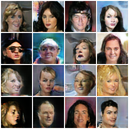
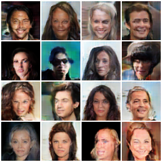
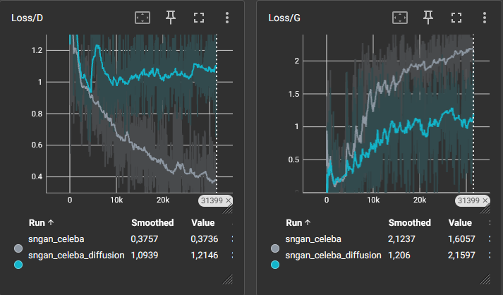

# Implémentation de Diffusion-GAN

Implémentation PyTorch de l'architecture **Diffusion-GAN** développé "from scratch" pour le projet de Deep Learning 2026.
Ce projet combine les GANs et les modèles de diffusion pour stabiliser l'entraînement et améliorer la génération d'images.

Pour plus de détails théoriques et une analyse complète, voir le rapport : [rapport.pdf](rapport.pdf) (généré depuis `rapport.tex`).

## Résultats Visuels

Comparaison à l'époque 200 sur le dataset CelebA (64x64).

|         Diffusion-GAN (Notre implémentation)         |                    Baseline SNGAN                    |
| :--------------------------------------------------: | :--------------------------------------------------: |
|  |  |

_Courbes d'apprentissage (Pertes Générateur/Discriminateur) :_



## Prérequis

- **Python 3.13** (Recommandé)
- **CUDA 12.x / 13.0** (Pour accélération GPU)
- Windows 10/11 (Testé sur cet environnement)

## Installation Rapide

1. **Créer l'environnement virtuel** :

   ```powershell
   python -3.13 -m venv venv
   .\venv\Scripts\Activate.ps1
   ```

2. **Installer les dépendances** :
   ```powershell
   pip install --pre torch torchvision --index-url https://download.pytorch.org/whl/nightly/cu128
   pip install -r requirements.txt
   ```

## Structure du Projet

```
diffusion-gan/
├── main.ipynb          # Notebook principal : Entraînement et Démonstration
├── rapport.tex         # Code source du rapport de projet
├── src/                # Code source Python
│   ├── models/         # Architectures (SNGAN, Generator, TimeEmbeddings)
│   ├── trainer.py      # Boucle d'entraînement et logique principale
│   ├── tools/          # Chargement de données et modèles
│   └── utils/          # Diffusion, Calcul FID, Fonctions de perte
├── data/               # Dossier de données (CelebA, CIFAR-10, MNIST)
├── runs/               # Logs TensorBoard et samples d'entraînement
├── models/             # Checkpoints sauvegardés (.pt)
├── imgs/               # Images pour le rapport et le README
└── docs/               # Documentation supplémentaire
```

## Utilisation

Ouvrez **`main.ipynb`** dans VS Code ou Jupyter Lab. Ce notebook contient toutes les étapes nécessaires pour :

1. Initialiser le modèle.
2. Lancer l'entraînement (ou charger un checkpoint).
3. Visualiser les résultats générés.

```powershell
# Lancer Jupyter Lab si nécessaire
jupyter lab main.ipynb
```

## Références

Basé sur le papier : _"Diffusion-GAN: Training GANs with Diffusion"_ (Wang et al., 2023).

Architecture ResNet inspirée de : _"Deep Residual Learning for Image Recognition"_ (He et al., 2016).
